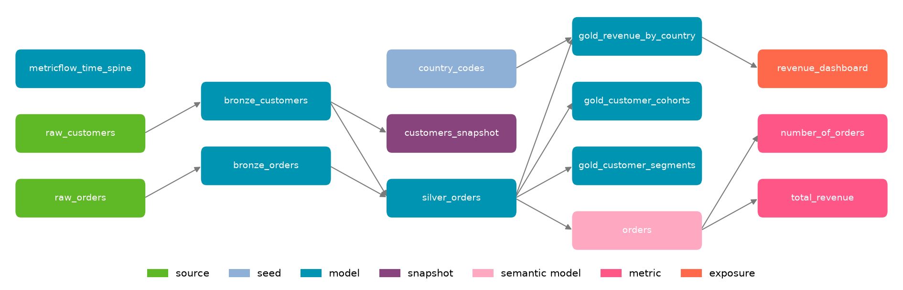

# dbt Hello World

[](https://github.com/simonerigoni/dbt_hello_world/actions/workflows/ci.yml?query=branch%3Amain) [](https://simonerigoni.github.io/dbt_hello_world/) [](LICENSE.md) [](pyproject.toml) [](https://github.com/astral-sh/uv) [](https://github.com/pre-commit/pre-commit) [](https://renovatebot.com)

## Introduction

A simple [dbt](https://www.getdbt.com/) Hello World that uses a local [DuckDB](https://duckdb.org/) database, so no server is needed. The raw data comes from two CSV files in the `data` folder at the root of the repository, declared as dbt sources and read directly by DuckDB. A small `country_codes` seed adds reference data. The data goes through three layers:

- **Bronze**: `bronze_customers` and `bronze_orders` are views over the raw sources, unchanged.
- **Silver**: `silver_orders` keeps only the completed orders, casts the types and adds the customer details. It is an incremental model, so after the first run it only processes the new orders instead of rebuilding the whole table.
- **Gold**: `gold_revenue_by_country` is a table with the number of orders, the revenue and the average order value per country, plus the country code and region from the seed. `gold_customer_segments` is a dbt Python model that gives every customer a `high`, `medium` or `low` segment by revenue. `gold_customer_cohorts` is a dbt Python model that groups customers by the month of their first completed order and computes the active customers and the retention rate for each following month.

Python does real work too. The `dbt_hello_world` package in `src/dbt_hello_world` has a `dbt-hello-world` command line tool that generates new random data, runs the dbt project with dbt's Python API and prints the gold layer, draws the lineage graph, and generates the static docs.

The project also shows:

- **Tests**: `unique`, `not_null`, `relationships` (every order has an existing customer) and `accepted_values` (an order is either completed or cancelled).
- **Singular test**: `tests/assert_gold_revenue_matches_silver.sql` is a custom SQL test that fails if the total revenue in the gold layer is different from the sum of the silver order amounts.
- **Unit test**: `models/silver/unit_tests.yml` gives `silver_orders` a few made-up orders and customers, one of them cancelled, and checks that only the completed orders come out with the customer details.
- **Snapshot**: `customers_snapshot` in `snapshots/customers_snapshot.yml` keeps the history of the customers. When a customer changes, the old version is closed and a new one is added (slowly changing dimension type 2).
- **Incremental model**: `silver_orders` uses `order_id` as unique key and, with `is_incremental()`, only reads the orders from the latest loaded date onwards.
- **Custom generic test**: `is_positive` in `tests/generic/is_positive.sql` is a reusable test written with ``, applied in the YAML files like the built-in ones. It checks that every value of a column is greater than 0, or at least 0 with the optional `allow_zero: true` argument. It runs on the silver `amount`, on the gold `number_of_orders`, `revenue`, `average_order_value` and `cohort_size`, and with `allow_zero: true` on the raw `amount`, where it only rejects negative amounts, and on the cohort `month_number`, `active_customers` and `retention_rate`.
- **Package**: `packages.yml` installs [dbt_utils](https://hub.getdbt.com/dbt-labs/dbt_utils/latest/), and its `not_empty_string` test checks that no silver order has an empty customer name.
- **Contract**: `gold_revenue_by_country` has an enforced contract, so the build fails if a column name or data type changes.
- **Source freshness**: every raw CSV file has a `_loaded_at` column and `sources.yml` sets `loaded_at_field` and a `freshness` block, so `dbt source freshness` checks how old the data is. It only has a `warn_after` of 1 day and no `error_after`: the sample data was loaded in early 2026 and never changes, so the check always warns that it is stale but never fails. The bronze views keep `_loaded_at`, the silver model drops it.
- **Exposure**: `models/exposures.yml` declares `revenue_dashboard`, a made-up dashboard that uses the gold layer, so the lineage graph ends in a consumer of the data.
- **Semantic layer**: `models/semantic_models.yml` defines the `orders` semantic model on `silver_orders`, with the `total_revenue` and `number_of_orders` metrics. `metricflow_time_spine` is the small time spine, one row per day of 2026, that the semantic layer needs.
- **Descriptions**: every source, seed, model and column is described in the YAML files, so they show up in the dbt docs. The longer ones are `` blocks in `models/docs.md`, used in the YAML files with `doc('...')`.
- **Analysis**: `analyses/top_customers_by_revenue.sql` lists the top 3 customers by revenue. `dbt compile` writes its SQL to `target/compiled`, but it is never built in the database.
- **Python models**: `models/gold/gold_customer_segments.py` and `models/gold/gold_customer_cohorts.py` are dbt Python models, a `model(dbt, session)` function instead of a SQL file. With dbt-duckdb they run inside DuckDB and `dbt.ref` returns a DuckDB relation, so they need no pandas. The segments model aggregates the silver orders with the relation methods `aggregate` and `project`. The cohorts model reads the silver orders and computes the monthly retention in Python.
- **Macro**: `safe_divide` in `macros/safe_divide.sql` divides and rounds, returning null instead of failing when the denominator is 0. The gold model uses it for the average order value.

## Software and libraries

This project uses Python 3.15, [uv](https://docs.astral.sh/uv/), `dbt-core`, `dbt-duckdb` and `duckdb`. It is a Python package with the `src` layout, built with `uv_build`. For development it also uses `matplotlib` for the lineage graph and `sqlfluff` with `sqlfluff-templater-dbt` to lint the SQL.

## Data

Have a look at the `data` folder and its [DATA.md](data/DATA.md) file.

## Local configuration

To set up a local environment and install all dependencies, run `uv sync` from the project folder.

Then run the checks with:

```bash
uv run pre-commit run --all-files
uv run pytest
```

## Code Quality

Code quality is maintained through automated checks and linting using pre-commit.

Pre-commit is a framework for managing and maintaining multi-language pre-commit hooks. A pre-commit hook is a script that runs before a commit operation in a version control system. This allows to shift left code quality checks and remediations. You can change the hooks by updating the file `.pre-commit-config.yaml`.

To trigger the pre-commit hooks without an actual commit you can run `uv run pre-commit run --all-files -v`.

It is also possible to run manually the individual tools:

- `uv run ruff check --fix`
- `uv run ruff format .`
- `uv run pyright .`
- `uv run sqlfluff lint dbt_project`
- `uv run sqlfluff fix dbt_project`

The SQL files are linted with [SQLFluff](https://sqlfluff.com/) and its dbt templater, so the Jinja is rendered by dbt before the SQL is checked. The settings are in `.sqlfluff`: DuckDB dialect, the core rules, lowercase keywords and a line length of 100. The dbt templater compiles the project, so run `uv run dbt deps` in `dbt_project` first.

## Testing

Tests are implemented using `pytest` and coverage is tracked with `pytest-cov`. The unit tests check the Python package:

- `tests/test_generator.py`: the same seed always gives the same data apart from `_loaded_at`, and the values are valid for the dbt tests, for example the countries match the `country_codes` seed and the amounts are positive
- `tests/test_cli.py`: the arguments and the defaults of every command, with dbt replaced by a fake
- `tests/test_lineage.py`: how the nodes are placed in columns and rows, the JSON description and the drawing

The integration tests in `tests/test_dbt_project.py` copy `dbt_project` and `data` to a temporary folder and runs `dbt deps` there, so nothing touches the local DuckDB file. Then it:

- runs `dbt build` twice, so all the data tests, including the custom generic test, the unit tests and the singular test run, also on the incremental model and the snapshot
- runs `dbt source freshness`, which warns because the sample data is old, but does not fail
- runs `dbt compile` and `dbt docs generate --static`
- lints the SQL files with SQLFluff, so the CI checks them too
- generates random data and runs the project on it with the runner of the CLI, twice, then reads the gold tables from DuckDB. The data is fresh, so the freshness check passes
- checks that the lineage graph is up to date: it parses the project, describes the graph like `dbt-hello-world lineage` does and compares it to the committed `images/dbt-dag.json`. The PNG bytes depend on the matplotlib version and the OS, so the test compares the description instead of the image. If it fails, run `uv run dbt-hello-world lineage` and commit both files

The detailed coverage report is generated by the pre-commit hook and it is available in [COVERAGE.md](COVERAGE.md) file.

It is also possible to run manually the individual tests:

- `uv run pytest`
- `uv run pytest tests/test_generator.py tests/test_cli.py tests/test_lineage.py`, only the fast unit tests
- `uv run pytest tests/test_dbt_project.py::test_dbt_build`

## Running the code

The easiest way is the `dbt-hello-world` command line tool, from the root of the repository:

| Command | What it does |
| --- | --- |
| `uv run dbt-hello-world run` | Runs `dbt deps` if the packages are missing, `dbt build` and `dbt source freshness` on the committed sample data, then prints the gold tables |
| `uv run dbt-hello-world generate` | Writes new random `raw_customers.csv` and `raw_orders.csv` to `temp/data` |
| `uv run dbt-hello-world run --data temp/data` | Same as `run`, on the generated data |
| `uv run dbt-hello-world all` | `generate` and then `run --full-refresh` on the new data, in one go |
| `uv run dbt-hello-world lineage` | Draws `images/dbt-dag.png` and writes `images/dbt-dag.json` |
| `uv run dbt-hello-world docs` | Generates the static docs (`dbt docs generate --static`) and opens `dbt_project/target/static_index.html` in the browser, the same file the Pages workflow publishes |

`docs` takes `--data` like `run`, and `--no-open` to write the HTML file without opening it. `generate` and `all` take `--customers` (default 10), `--orders` (default 50), `--seed` (default 42), `--output` (default `temp/data`) and `--loaded-at`. The same seed always gives the same data. Only `_loaded_at` changes, it is the current time unless `--loaded-at` is given, so the freshness check passes on freshly generated data. The countries are the ones in the `country_codes` seed and the orders are in 2026, so all the tests pass.

### Using generated data

`generate` writes `raw_customers.csv` and `raw_orders.csv` to `temp/data`, which Git ignores, so the committed samples in `data` are never overwritten.

`run --data temp/data` sets `DBT_HELLO_WORLD_DATA` to that folder. In `sources.yml` this variable is the folder of the CSV files, and it defaults to `../data`, the committed samples. It also sets `DBT_HELLO_WORLD_DATABASE` to a `dbt_hello_world.duckdb` file inside the same folder, so the incremental model and the snapshot of one data set never mix with another. Bronze then reads the generated CSVs, and everything downstream follows from there.

After generating new data into the same folder, use `run --data temp/data --full-refresh` so the incremental model and the snapshot start from scratch. `all` does both steps in one go.

The same thing works with plain dbt, from the `dbt_project` folder:

```bash
DBT_HELLO_WORLD_DATA=../temp/data DBT_HELLO_WORLD_DATABASE=../temp/data/dbt_hello_world.duckdb uv run dbt build
```

Run `uv run dbt-hello-world --help` or `uv run dbt-hello-world <command> --help` for all the options.

All the dbt files are in the `dbt_project` folder. From the `dbt_project` folder, first run `uv run dbt deps` to install the `dbt_utils` package, then `uv run dbt build` to load the seed, build the models and the snapshot and run the tests. The data ends up in the local `dbt_hello_world.duckdb` file.

To see the gold layer, run `uv run dbt show --select gold_revenue_by_country`. `dbt show` cannot preview Python models, so use `uv run dbt-hello-world run` to see `gold_customer_segments` and `gold_customer_cohorts`. To check the freshness of the raw data, run `uv run dbt source freshness`: it warns that the sample data is stale, which is expected.

The metrics are parsed and validated by dbt, but querying them needs [MetricFlow](https://docs.getdbt.com/docs/build/about-metricflow) or dbt Cloud. MetricFlow is not a dependency of the project, but it can be run on the fly with uv, for example after a `dbt build`:

```bash
uv run --with dbt-metricflow mf query --metrics total_revenue,number_of_orders --group-by order__country
uv run --with dbt-metricflow mf query --metrics total_revenue --group-by metric_time__month
```

## Basic dbt commands

Run them from the `dbt_project` folder, prefixed with `uv run`.

| Command | What it does |
| --- | --- |
| `dbt parse` | Parses the project and writes `target/manifest.json`, a quick check of the YAML and Jinja |
| `dbt debug` | Checks the installation, `profiles.yml` and the database connection |
| `dbt deps` | Installs the packages listed in `packages.yml` |
| `dbt seed` | Loads the CSV files in `seeds` into the database |
| `dbt run` | Builds the models |
| `dbt run --full-refresh` | Rebuilds the incremental models from scratch |
| `dbt snapshot` | Runs the snapshots |
| `dbt test` | Runs the data tests and the unit tests |
| `dbt test --select test_type:unit` | Runs only the unit tests |
| `dbt test --select test_type:singular` | Runs only the singular tests in `tests` |
| `dbt test --select test_name:is_positive` | Runs only the `is_positive` custom generic test |
| `dbt source freshness` | Checks how old the raw data is, using `_loaded_at` |
| `dbt build` | Runs seeds, models, snapshots and tests in dependency order |
| `dbt run --select silver_orders+` | Builds `silver_orders` and everything downstream of it |
| `dbt show --select gold_revenue_by_country` | Previews the rows of a model |
| `dbt compile` | Writes the compiled SQL of the models, tests and analyses to `target` without running it |
| `dbt ls` | Lists the resources in the project |
| `dbt docs generate` | Generates the documentation and the lineage graph |
| `dbt docs generate --static` | Generates the documentation as a single `target/static_index.html` file |
| `dbt docs serve` | Serves the documentation in the browser |
| `dbt clean` | Deletes the `target` and `dbt_packages` folders |

## Lineage graph

This is the lineage graph of the project, with the same colors as in the dbt docs, from the sources to the exposure and the metrics. It is generated by `uv run dbt-hello-world lineage`, which parses the project and draws `images/dbt-dag.png` with matplotlib, see `src/dbt_hello_world/lineage.py`. It also writes `images/dbt-dag.json`, a text description of the nodes, edges and layout of the graph. After changing the project, run `uv run dbt-hello-world lineage` to update both files.



The dbt docs, with the interactive lineage graph, are published on GitHub Pages at [simonerigoni.github.io/dbt_hello_world](https://simonerigoni.github.io/dbt_hello_world/). The `Docs` workflow in `.github/workflows/docs.yml` builds the project, generates the static docs and deploys them on every push to `main`.

To browse the docs locally, run `uv run dbt-hello-world docs` from the root of the repository: it generates the same `target/static_index.html` file as the Pages workflow and opens it in the browser. Use `--no-open` to only write the file. From the `dbt_project` folder you can also run `uv run dbt docs generate` and then `uv run dbt docs serve` for the interactive docs, or `uv run dbt docs generate --static` and open `target/static_index.html`.

## List of activities

In the [TODO.md](TODO.md) file you can find the list of tasks and on going activities.

## Licensing and acknowledgements

Have a look at [LICENSE.md](LICENSE.md).

## Outro

I hope this repository was interesting and thank you for taking the time to check it out. On my Medium you can find a more in depth [story](https://medium.com/@simone-rigoni01/hello-world-from-dbt-ec4c4315056c). Let me know if you have any question and if you like the content that I create feel free to [buy me a coffee](https://www.buymeacoffee.com/simonerigoni).
