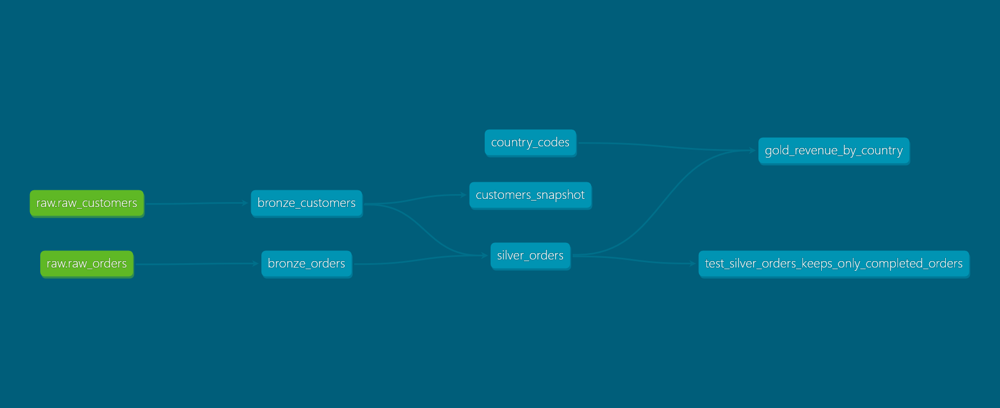

# dbt Hello World

## Introduction

A simple [dbt](https://www.getdbt.com/) Hello World that uses a local [DuckDB](https://duckdb.org/) database, so no server is needed. The raw data comes from two CSV files in `dbt_project/data`, declared as dbt sources and read directly by DuckDB. A small `country_codes` seed adds reference data. The data goes through three layers:

- **Bronze**: `bronze_customers` and `bronze_orders` are views over the raw sources, unchanged.
- **Silver**: `silver_orders` keeps only the completed orders, casts the types and adds the customer details. It is an incremental model, so after the first run it only processes the new orders instead of rebuilding the whole table.
- **Gold**: `gold_revenue_by_country` is a table with the number of orders, the revenue and the average order value per country, plus the country code and region from the seed.

The project also shows:

- **Tests**: `unique`, `not_null`, `relationships` (every order has an existing customer) and `accepted_values` (an order is either completed or cancelled).
- **Unit test**: `models/silver/unit_tests.yml` gives `silver_orders` a few made-up orders and customers, one of them cancelled, and checks that only the completed orders come out with the customer details.
- **Snapshot**: `customers_snapshot` in `snapshots/customers_snapshot.yml` keeps the history of the customers. When a customer changes, the old version is closed and a new one is added (slowly changing dimension type 2).
- **Incremental model**: `silver_orders` uses `order_id` as unique key and, with `is_incremental()`, only reads the orders from the latest loaded date onwards.
- **Package**: `packages.yml` installs [dbt_utils](https://hub.getdbt.com/dbt-labs/dbt_utils/latest/), and its `accepted_range` test checks that every order amount is greater than 0.
- **Contract**: `gold_revenue_by_country` has an enforced contract, so the build fails if a column name or data type changes.
- **Descriptions**: every source, seed, model and column is described in the YAML files, so they show up in the dbt docs.
- **Macro**: `safe_divide` in `macros/safe_divide.sql` divides and rounds, returning null instead of failing when the denominator is 0. The gold model uses it for the average order value.

## Software and libraries

This project uses Python 3.11, [uv](https://docs.astral.sh/uv/), `dbt-core` and `dbt-duckdb`.

## Running the code

All the dbt files are in the `dbt_project` folder. From the `dbt_project` folder, first run `uv run dbt deps` to install the `dbt_utils` package, then `uv run dbt build` to load the seed, build the models and the snapshot and run the tests. The data ends up in the local `dbt_hello_world.duckdb` file.

To see the gold layer, run `uv run dbt show --select gold_revenue_by_country`.

## Basic dbt commands

Run them from the `dbt_project` folder, prefixed with `uv run`.

| Command | What it does |
| --- | --- |
| `dbt debug` | Checks the installation, `profiles.yml` and the database connection |
| `dbt deps` | Installs the packages listed in `packages.yml` |
| `dbt seed` | Loads the CSV files in `seeds` into the database |
| `dbt run` | Builds the models |
| `dbt run --full-refresh` | Rebuilds the incremental models from scratch |
| `dbt snapshot` | Runs the snapshots |
| `dbt test` | Runs the data tests and the unit tests |
| `dbt test --select test_type:unit` | Runs only the unit tests |
| `dbt build` | Runs seeds, models, snapshots and tests in dependency order |
| `dbt run --select silver_orders+` | Builds `silver_orders` and everything downstream of it |
| `dbt show --select gold_revenue_by_country` | Previews the rows of a model |
| `dbt compile` | Writes the compiled SQL to `target` without running it |
| `dbt ls` | Lists the resources in the project |
| `dbt docs generate` | Generates the documentation and the lineage graph |
| `dbt docs serve` | Serves the documentation in the browser |
| `dbt clean` | Deletes the `target` and `dbt_packages` folders |

## Lineage graph

This is the lineage graph of the project, with the same colors as in the dbt docs. It is generated by `generate_lineage.py`, which parses the project and draws `images/dbt-dag.png` with matplotlib. After changing the project, run `uv run generate_lineage.py` from the root of the repository to update it.

To browse the interactive docs, from the `dbt_project` folder run `uv run dbt docs generate` and then `uv run dbt docs serve`. To get a single HTML file that opens without a server, run `uv run dbt docs generate --static` and open `target/static_index.html`.

For comparison, this is the same lineage graph exported by hand from the static docs, as `images/dbt-dag-static.png`. Unlike `dbt-dag.png`, it is not regenerated by the script, so it has to be exported again after changing the project.

## Licensing and acknowledgements

Have a look at [LICENSE](LICENSE).
